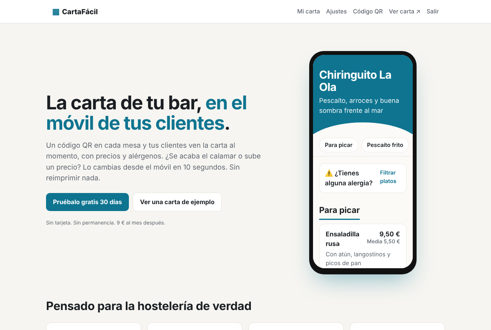
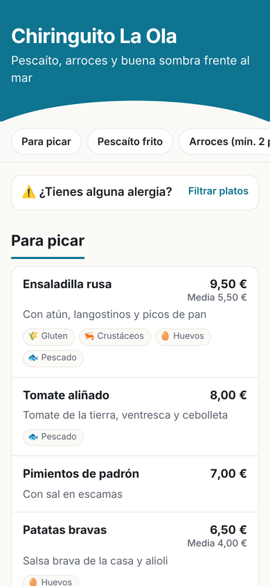
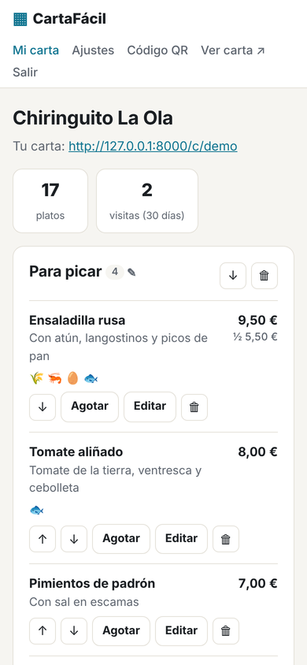
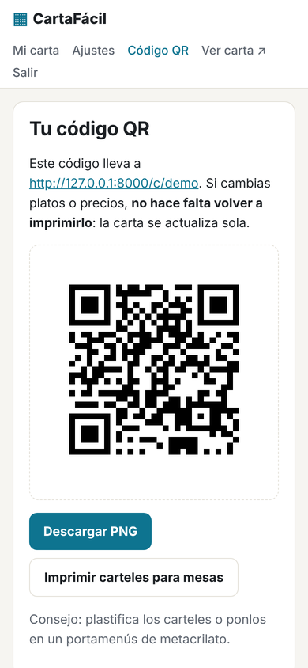
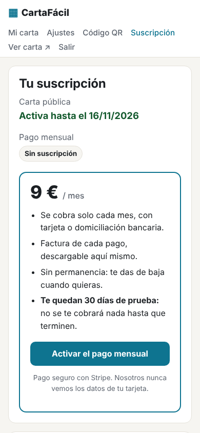

# CartaFácil

**Carta digital con código QR para bares, restaurantes y chiringuitos.**

El local pone un QR en cada mesa y los clientes ven la carta en el móvil, con precios y alérgenos. Cuando cambia un precio o se acaba un plato, el dueño lo edita desde su móvil y se actualiza al momento en todas las mesas, sin reimprimir nada.

Es un proyecto personal desarrollado en PHP y MySQL, sin frameworks ni dependencias externas, pensado como un pequeño SaaS por suscripción.



<p>
  
  
  
</p>

## Funcionalidades

**Para el cliente del bar**
- Carta adaptada al móvil, con navegación por secciones y legible a pleno sol.
- Los 14 alérgenos de declaración obligatoria (Reglamento UE 1169/2011) en cada plato.
- Filtro de alérgenos: el cliente marca lo que no puede tomar y se ocultan los platos que lo contienen.
- Precio de ración y de media ración, y platos marcados como "agotado hoy".
- Sin aplicaciones ni registro, y sin cookies.

**Para el dueño del local**
- Registro con 30 días de prueba y recuperación de contraseña por correo (enlace de un solo uso que caduca en 1 hora).
- Panel para crear categorías y platos, ordenarlos, editar precios y alérgenos, y marcar agotados con un toque.
- Dirección propia para su carta (`/c/nombre-del-bar`), color de marca, teléfono, dirección y nota al pie.
- Código QR descargable en PNG y carteles imprimibles para las mesas (6 por hoja A4).
- Estadística de visitas de los últimos 30 días.
- Suscripción mensual con Stripe (tarjeta o domiciliación), con facturas descargables, cambio de tarjeta y baja desde el propio panel. También admite pago manual por Bizum o transferencia.



## Tecnología

| | |
|---|---|
| Backend | PHP 8.1+ sin frameworks, con PDO |
| Base de datos | MySQL / MariaDB en producción, SQLite para desarrollo local |
| Frontend | HTML, CSS y JavaScript sin librerías; diseño responsive |
| Pagos | API REST de Stripe (Checkout, Billing Portal y webhooks firmados), sin SDK |
| Correo | `mail()` de PHP o cliente SMTP propio con STARTTLS/SSL |
| QR | Generador en JavaScript incluido en el proyecto, sin depender de servicios externos |

## Seguridad

- Contraseñas cifradas con `password_hash` y rehash automático.
- Consultas preparadas en todas las operaciones con la base de datos.
- Token CSRF en todos los formularios y escape de toda la salida HTML.
- Cada local solo puede leer y modificar sus propios datos (comprobación de propiedad en cada acción).
- Límite de intentos de login y de peticiones de recuperación de contraseña.
- Cookie de sesión `HttpOnly` y `SameSite`, con regeneración del identificador al iniciar sesión.
- Verificación de firma HMAC en los webhooks de Stripe.
- La recuperación de contraseña no revela qué correos están registrados.
- Carpetas internas (`app/`, `sql/`, `data/`) bloqueadas desde la web.

## Estructura

```
CartaFacil/
├── index.php              Página de venta
├── registro.php, login.php, olvide.php, restablecer.php
├── carta.php              Carta pública (/c/nombre-del-bar)
├── webhook-stripe.php     Avisos de pago de Stripe
├── panel/                 Panel del local: carta, ajustes, QR y suscripción
├── app/                   Configuración, base de datos, plantillas, correo y Stripe
├── assets/                CSS, JavaScript (generador de QR) e iconos
├── sql/                   Esquemas MySQL y SQLite, actualizaciones e instalador
└── demo/                  Carta de ejemplo en un solo archivo HTML
```

## Probarlo en local

Con PHP 8.1 o superior y sin instalar MySQL:

```bash
cp app/config.example.php app/config.php
# En app/config.php, cambia 'driver' => 'mysql' por 'driver' => 'sqlite'
# y 'base_url' por 'http://localhost:8000'
php sql/instalar.php --demo
php -S localhost:8000 router.php
```

Abre http://localhost:8000 y entra con `demo@cartafacil.es` / `demo1234`.

Las instrucciones completas (XAMPP, subida a un hosting, configuración del correo y de Stripe) están en [LEEME.md](LEEME.md).

## Autor

Arturo Jiménez Navarrete, estudiante de 2.º de Desarrollo de Aplicaciones Web (DAW).
